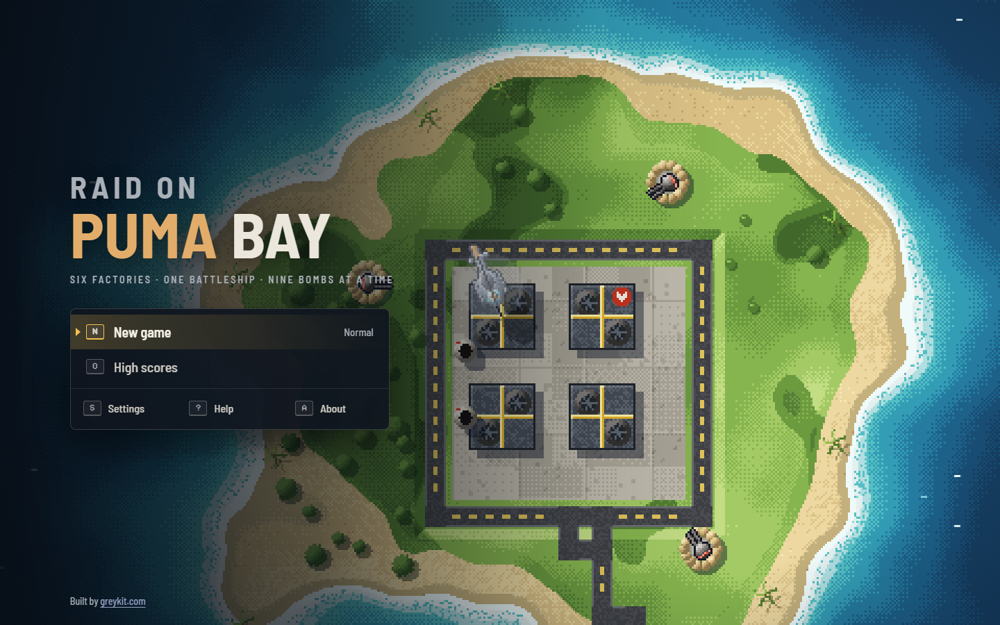
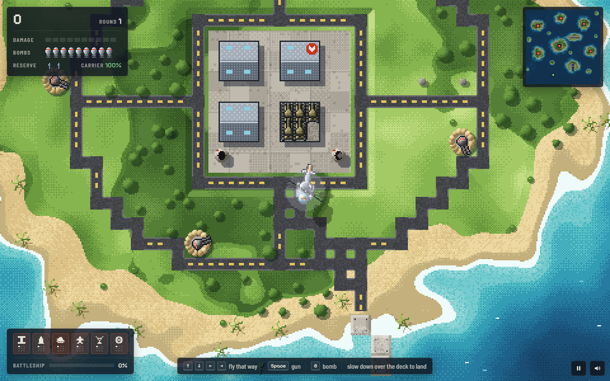

# Raid on Puma Bay

**Six factories, one secret battleship, nine bombs at a time.** A remake of *Raid on Bungeling Bay* (Broderbund, 1984, Commodore 64): a puma flies a helicopter off a carrier against the Wolf Empire, drawn as modern pixel art seen straight down.

**Play:** [greykit.com/games/raidonpumabay](https://greykit.com/games/raidonpumabay/)

## How it plays

The Wolf Empire has six factories on the islands of Puma Bay and a battleship building in a secret yard. You fly off your carrier with nine bombs. Knock down all four buildings of a factory and it is gone; leave one standing and the enemy rebuilds the rest. Each factory improves one line of the enemy's war while it stands: the battleship's hull, flak, tanks, fighters and bombers, radar, the battleship's engines. Destroy all six and the round is won; the next is the same bay, rebuilt, with the enemy further along.

The airfield scrambles fighters until its hangars are bombed. Cargo ships carry parts to the yard, and once the battleship sails it hunts the carrier. Land on the deck, slowly, to be patched up and loaded again. Lose every helicopter, or the carrier, and the raid is over. The bay wraps round at its edges.

**Classic** flies as 1984 did: the gauges and your eyes. **Field**, the default, adds the radar chart, edge arrows, a bomb sight, a landing guide and leaving a game to come back to it; Settings has each on its own. Steering is a separate setting: **Classic** turns and thrusts as 1984 did, **Modern** flies the way the stick points.

## Keys

| | |
|---|---|
| Arrows or WASD | Classic: turn, forward, brake. Modern: fly that way (`Shift` brakes) |
| `Space` / `J` | gun |
| `B` / `X` / `K` | bomb; hold for a stick |
| `Tab` | the chart; the game waits |
| `Esc` / `P` | pause |
| `L` | Classic or Field |
| `M` | sound |

A gamepad works too.

## Saves

Kept in the browser's `localStorage` under keys starting `raidonpumabay_`. **Settings → Forget everything** clears them.

## Credits

The original *Raid on Bungeling Bay* was designed and drawn by Will Wright for Broderbund, 1984. Raid on Puma Bay is not affiliated with Broderbund and uses none of the original's code, art, sound or text.

Typefaces: [Barlow Semi Condensed](https://fonts.google.com/specimen/Barlow+Semi+Condensed) and [Pixelify Sans](https://fonts.google.com/specimen/Pixelify+Sans), under the SIL Open Font License.

Working on the game: [DEVELOPMENT.md](DEVELOPMENT.md).

By Matthew "Shan" Romanek, with Claude. Built by [greykit.com](https://greykit.com/).

Made for my own play. Nothing here is offered: no support, no updates, no licence.
