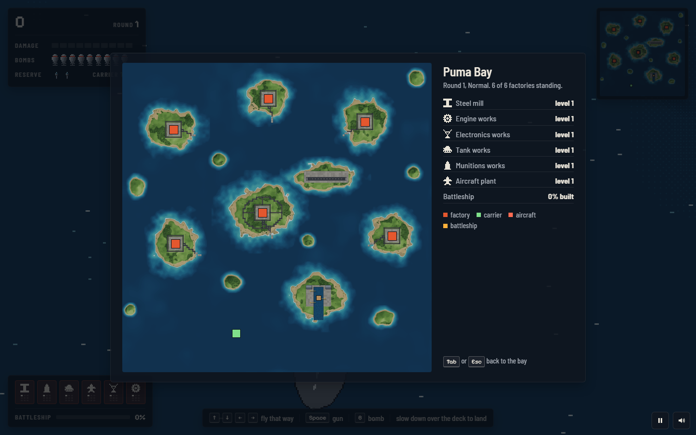

# Raid on Puma Bay

**Six factories, one secret battleship, nine bombs at a time.** A remake of *Raid on Bungeling Bay* (Broderbund, 1984, Commodore 64): a puma flies a helicopter off a carrier against the Wolf Empire, drawn as modern pixel art seen straight down.

## Play

[greykit.com/games/raidonpumabay](https://greykit.com/games/raidonpumabay/)

No install required. Plain scripts, no build step, nothing fetched at play time: every picture is drawn and every sound synthesised in the page; the two typefaces ship with it.


## How it plays

The Wolf Empire has six factories on the islands of Puma Bay, and a battleship building in a secret yard. You fly off your carrier in the south-west with nine bombs. Knock down all four buildings of a factory and it is gone; leave one standing and the enemy rebuilds the rest. Destroy all six and the round is won, and the next round is the same bay, rebuilt, with the enemy further along.


Each factory feeds one line of the enemy's war, and the line improves while the factory stands:

| Factory | Its line |
|---|---|
| Steel mill | the battleship's hull, and the rebuilding of the other factories |
| Munitions works | flak that fires faster and bursts wider |
| Tank works | more tanks on the island roads |
| Aircraft plant | faster fighters, more of them, and bombers sent at the carrier |
| Electronics works | radar that sees further, and fighters with homing missiles |
| Engine works | the battleship built faster |

Radar sees you coming and the airfield scrambles fighters; bomb its three hangars and nothing takes off until one is rebuilt. Cargo ships carry parts from every factory's dock to the yard, and each that arrives brings the battleship closer; bombs on the yard set the work back. Once it sails it hunts the carrier. Land on the carrier's deck, slowly, to be patched up and loaded again. Lose every helicopter, or the carrier, and the raid is over. The bay wraps round at its edges.



## Classic and Field

**Classic** flies as 1984 did: the gauges and your eyes. **Field**, the default, adds the radar chart, arrows at the screen's edge toward the carrier, the battleship and enemy aircraft, a bomb sight, a landing guide, and leaving a game to come back to it. Settings has each on its own; `L` switches the set in the air.

Steering is a setting of its own, under Controls. **Classic**, the default, turns and thrusts as 1984 did: left and right turn the helicopter, up flies forward, down brakes. **Modern** flies the helicopter the way the stick points.

## Keys

| | |
|---|---|
| Arrows or WASD | Classic controls (the default): turn, forward, brake. Modern: fly that way (`Shift` brakes) |
| `Space` / `J` | gun |
| `B` / `X` / `K` | bomb; hold for a stick |
| `Tab` | the chart; the game waits |
| `Esc` / `P` | pause |
| `L` | Classic or Field |
| `M` | sound |

A gamepad works too.

## Code

```
js/engine/   the game, DOM-free: the map, the helicopter and carrier, the enemy, a step of it all, and a bot
js/art/      the pixel art: the sprite rasteriser, vehicles, buildings, effects, the painted bay
js/          rendering, the HUD, input, sound, the screens, settings and scores, and the loop
tools/       sim-check (the bot plays every difficulty headless), asset stamps and checks, icons, the share card
```

`node tools/sim-check.js` plays the game headless: the map is sound, the bot wins round one on Easy every time and on Normal at least once, and a game replays step for step. `node tools/stamp-assets.js` stamps every script and stylesheet with its hash after an edit. `tools/preview.html` is the sprite sheet; `tools/og.html` draws the share card.

## Credits

The original *Raid on Bungeling Bay* was designed and drawn by Will Wright for Broderbund, 1984. This remake is not affiliated with Broderbund; no code, art or audio from it is used.

Built by [greykit.com](https://greykit.com/). MIT licence.
